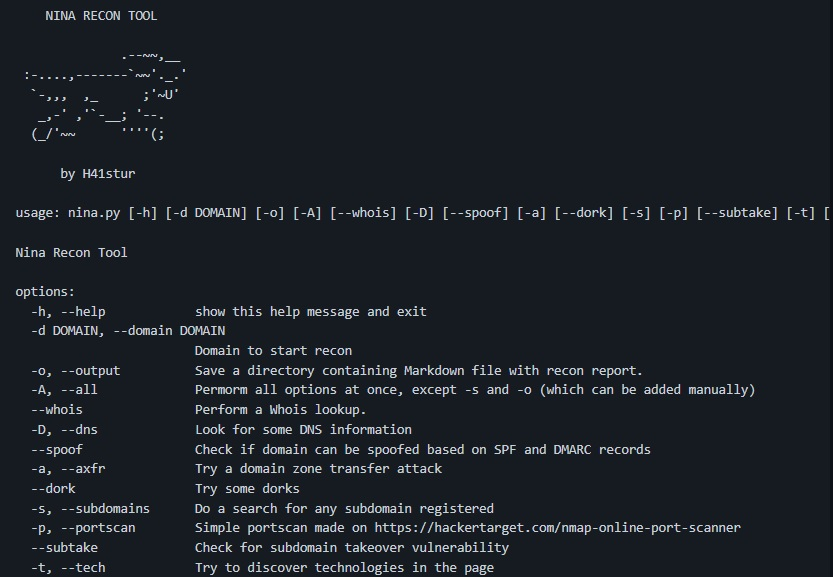

O teste de penetração, ou pentesting, é a prática de simular um ataque cibernético em um sistema de computador, rede ou aplicativo da web para testar suas defesas e identificar vulnerabilidades.

  * Introdução
  * Osint
  * Recon
  * [Dica de ferramenta](<https://github.com/h41stur/nina>)
  * Siga as regras

# **OSINT e Recon em testes de penetração**

O teste de penetração, ou pentesting, é a prática de simular um ataque cibernético em um sistema de computador, rede ou aplicativo da web para testar suas defesas e identificar vulnerabilidades. OSINT (Open Source Intelligence) é o processo de coleta, análise e divulgação de informações de fontes publicamente disponíveis e é uma ferramenta importante para os pentesters coletarem informações sobre um alvo. As ferramentas Recon são programas de software especializados que podem ser usados para automatizar o processo de coleta e análise de dados OSINT.

## **O papel do OSINT no teste de penetração**

OSINT desempenha um papel crucial no planejamento e execução de um pentest. Ele pode ser usado para coletar informações sobre a infraestrutura, os funcionários e a presença online de um alvo, bem como para identificar possíveis vulnerabilidades e fraquezas. Essas informações podem ajudar os pentesters a desenvolver um plano de ataque direcionado e a escolher as ferramentas e técnicas mais apropriadas para o teste.

Por exemplo, um pentester pode usar OSINT para coletar informações sobre a arquitetura de rede do alvo, os tipos de sistemas e dispositivos que usa e suas configurações de software e hardware. Essas informações podem ser usadas para identificar possíveis vulnerabilidades e planejar um ataque que aproveite essas fraquezas.

O OSINT também pode ser usado para coletar informações sobre os funcionários do alvo, como seus nomes, cargos e responsabilidades. Essas informações podem ser úteis para criar ataques de phishing direcionados ou para se passar por funcionários para obter acesso a dados ou sistemas confidenciais.

Por fim, o OSINT pode ser usado para coletar informações sobre a presença online do alvo, como seu site, contas de mídia social e registros públicos. Essas informações podem ser usadas para identificar possíveis pontos de entrada para um ataque ou para coletar informações adicionais sobre as operações e defesas do alvo.

## **Ferramentas de reconhecimento e seu papel no OSINT**

As ferramentas Recon são programas de software especializados que podem ser usados para automatizar o processo de coleta e análise de dados OSINT. Essas ferramentas podem ser particularmente úteis para pentesters, pois podem ajudar a simplificar o processo de coleta e análise de grandes quantidades de dados de várias fontes.

Existem muitos tipos diferentes de ferramentas de reconhecimento disponíveis, cada uma com seu próprio conjunto de recursos e capacidades. Alguns exemplos comuns incluem mecanismos de pesquisa, plataformas de mídia social e ferramentas OSINT especializadas, como [Maltego](<https://www.maltego.com/maltego-community>), [Recon-ng](<https://github.com/lanmaster53/recon-ng>) e [SpiderFoot](<https://www.spiderfoot.net/documentation/>).

Os mecanismos de pesquisa são talvez a ferramenta de reconhecimento mais amplamente usada e podem ser usados para pesquisar uma ampla gama de informações, incluindo sites, artigos de notícias e postagens de mídia social. Os mecanismos de pesquisa usam algoritmos para classificar e priorizar os resultados da pesquisa e podem ser personalizados para filtrar os resultados com base em critérios específicos.

As plataformas de mídia social são outra fonte importante de dados OSINT e podem ser usadas para coletar informações sobre indivíduos, organizações e eventos. Muitas plataformas de mídia social oferecem recursos avançados de pesquisa e APIs que podem ser usados para automatizar o processo de coleta e análise de dados.

Muitas ferramentas são criadas pelos próprios pentesters para obtenção de informações especificas dos alvos, entre as diversas posso indicar o [NINA](<https://github.com/h41stur/nina>) O NINA é descrita pelo seu desenvolvedor como: _“Nina é uma ferramenta projetada para realizar reconhecimento básico de domínios e seus subdomínios. Esta ferramenta foi feita pensando em economizar tempo na fase inicial de testes de penetração/recompensa de bugs”_. 

As ferramentas OSINT especializadas, como Maltego e Recon-ng ou até mesmo o NINA são projetadas especificamente para coletar e analisar dados OSINT. Essas ferramentas geralmente têm uma ampla gama de recursos e capacidades, incluindo a capacidade de coletar dados de várias fontes, visualizar e analisar dados e automatizar o processo de coleta de dados.

## **Usando ferramentas OSINT e Recon de forma eficaz**

Para usar as ferramentas OSINT e recon efetivamente em um pentest, é importante ter uma compreensão clara das metas e objetivos do teste, bem como das defesas e vulnerabilidades do alvo. Isso ajudará a focar a pesquisa e garantir que informações relevantes sejam coletadas. Também é importante usar uma variedade de fontes e ferramentas para cruzar informações e verificar sua precisão. Isso pode ajudar a garantir que as informações coletadas sejam confiáveis e possam ser confiáveis. Finalmente, é importante usar ferramentas OSINT e recon de forma ética e responsável. Isso inclui respeitar a privacidade de indivíduos e organizações e evitar qualquer ação que viole as leis vigentes.
