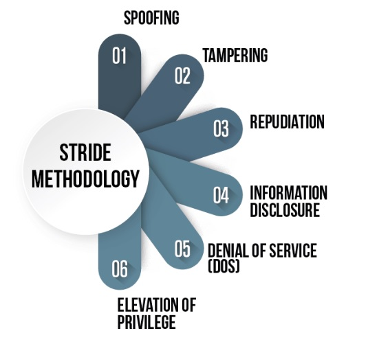
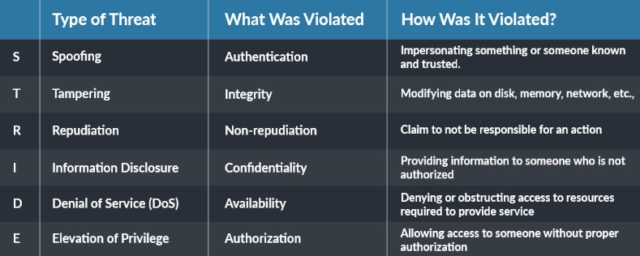
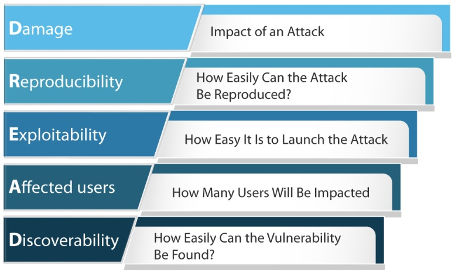
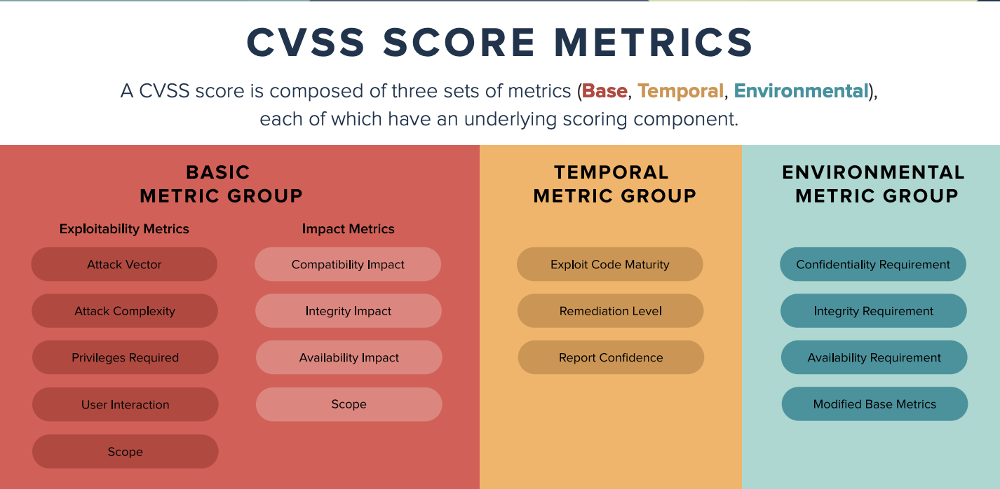
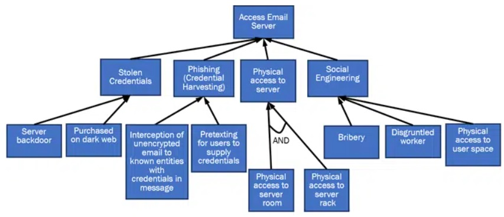
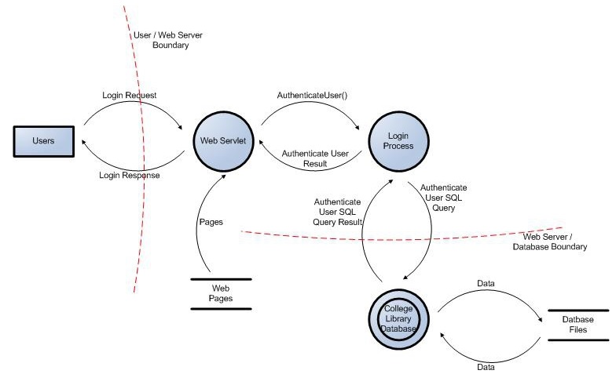
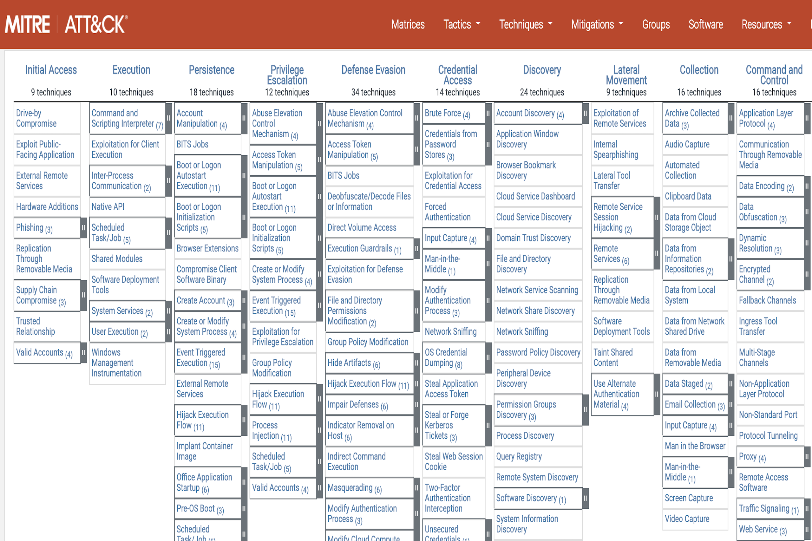

* Introdução
  * O que é Modelagem de ameaças?
  * Beneficíos da modelagem
  * Processo recomendado
  * Metodologias e frameworks
  * Ferramentas

# **Modelagem de ameaças em testes de intrusão**

A modelagem de ameaças é um aspecto importante de qualquer envolvimento de teste de penetração. Envolve identificar, analisar e priorizar as ameaças potenciais aos sistemas e ativos de uma organização. Ao entender as ameaças que uma organização enfrenta, os testadores de penetração podem projetar e executar testes que reflitam com precisão os riscos do mundo real que a organização enfrenta.

## **O que é a Modelagem de Ameaças?**

A modelagem de ameaças é uma abordagem estruturada para identificar, analisar e priorizar as ameaças potenciais aos sistemas e ativos de uma organização. Envolve uma análise sistemática das vulnerabilidades de uma organização e dos impactos potenciais de um ataque bem-sucedido. Essa análise é usada para informar o projeto e a execução de um teste de penetração, garantindo que o teste reflita com precisão os riscos do mundo real enfrentados pela organização.

## **Benefícios da modelagem de ameaças**

Há vários benefícios em realizar a modelagem de ameaças durante um teste de penetração:

  1. **Postura de segurança aprimorada:** ao identificar e analisar possíveis ameaças, uma organização pode entender melhor suas vulnerabilidades e tomar medidas para mitigá-las. Isso pode ajudar a melhorar a postura geral de segurança da organização.
  2. **Testes mais direcionados:** a modelagem de ameaças permite que os testadores de penetração concentrem seus esforços nas áreas de maior risco, em vez de testar cegamente todos os sistemas e ativos. Isso torna o processo de teste mais eficiente e econômico.
  3. **Maior valor:** Ao segmentar as áreas de maior risco, a modelagem de ameaças ajuda a garantir que os resultados de um teste de penetração sejam de maior valor para a organização. Isso pode ajudar a justificar o custo do teste e garantir que a organização obtenha um bom retorno sobre o investimento.

## **Processo de modelagem de ameaças**

O processo de modelagem de ameaças normalmente envolve as seguintes etapas:

  1. **Identificar ativos:** O primeiro passo na modelagem de ameaças é identificar os sistemas e ativos que precisam ser protegidos. Isso inclui tudo, desde hardware e software até dados e propriedade intelectual.
  2. **Identificar ameaças:** A próxima etapa é identificar as ameaças potenciais aos ativos identificados. Isso pode incluir ameaças externas, como hackers e atores do Estado-nação, bem como ameaças internas, como funcionários descontentes.
  3. **Analisar vulnerabilidades:** Uma vez que as ameaças tenham sido identificadas, o próximo passo é analisar as vulnerabilidades que podem ser exploradas por essas ameaças. Isso pode incluir a identificação de fraquezas em sistemas e processos, bem como fatores humanos, como falta de treinamento ou conscientização.
  4. **Priorizar riscos:** A etapa final no processo de modelagem de ameaças é priorizar os riscos com base na probabilidade e no impacto potencial de um ataque bem-sucedido. Isso permite que a organização concentre seus esforços nas áreas de maior risco e aloque recursos adequadamente.

## **Metodologias de modelagem de ameaças e analise de risco**

### STRIDE

STRIDE é uma ferramenta de modelagem de ameaças desenvolvida pela Microsoft que ajuda a identificar e classificar ameaças potenciais.

Ele significa:

  1. Falsificação de identidade do usuário
  2. adulteração de dados
  3. Repúdio
  4. Divulgação de informação
  5. Negação de serviço
  6. Elevação de privilégio

Usando o STRIDE, as organizações podem identificar ameaças potenciais e avaliar sua probabilidade e impacto.

### DREAD

O DREAD é outra ferramenta de modelagem de ameaças que ajuda a avaliar o risco de ameaças potenciais. Ele significa:

  1. Potencial de dano
  2. Reprodutibilidade
  3. Explorabilidade
  4. Usuários afetados
  5. Descoberta

Usando o DREAD, as organizações podem atribuir uma pontuação de risco a cada ameaça potencial, que pode ser usada para priorizar quais ameaças devem ser abordadas primeiro.

### CVSS

O Common Vulnerability Scoring System (CVSS) é um método padronizado para avaliar a gravidade das vulnerabilidades. Ele fornece uma maneira consistente e objetiva de avaliar o risco representado por uma vulnerabilidade e pode ser usado para priorizar a necessidade de correção ou outros esforços de correção.

### Árvore de Ameaças (Threat Tree)

Uma árvore de ameaças é uma representação visual das ameaças potenciais a um ativo, juntamente com os controles em vigor para mitigar essas ameaças. Ele pode ser usado para identificar vulnerabilidades potenciais e avaliar a eficácia dos controles existentes. A imagem abaixo exemplifica uma Árvore de ataque de servidor de e-mail com táticas.

### Estrutura de modelagem de ameaças OWASP (OWASP Threat Modeling Framework)

O Open Web Application Security Project (OWASP) desenvolveu uma estrutura de modelagem de ameaças que ajuda as organizações a identificar, avaliar e priorizar possíveis ameaças a seus aplicativos da web. A estrutura OWASP consiste em um conjunto de melhores práticas e uma ferramenta para criar uma representação visual das ameaças a um aplicativo da web. A seguir um exemplo de Diagrama de fluxo de dados de login do usuário para o site da biblioteca da faculdade.

### MITRE ATT&CK Framework

A MITRE Corporation desenvolveu a estrutura Adversarial Tactics, Techniques, and Common Knowledge (ATT&CK), que é um modelo abrangente das táticas, técnicas e procedimentos usados pelos adversários. Ele pode ser usado para ajudar as organizações a entender os métodos usados pelos invasores e identificar possíveis ameaças aos seus sistemas. A imagem abaixo demonstra o modelo Mitre

## **Ferramentas de modelagem de ameaças**

[Ferramenta de modelagem de ameaças da Microsoft](<https://docs.microsoft.com/en-us/azure/security/develop/threat-modeling-tool>) A Ferramenta de Modelagem de Ameaças da Microsoft é gratuita e permite que os arquitetos de software identifiquem e mitiguem os problemas de segurança mais prováveis ​​em um estágio inicial, quando eles são comparativamente fáceis e econômicos de corrigir. Assim, reduzindo o custo total de desenvolvimento.

ThreatModeler(https://threatmodeler.com/) O ThreatModeler é uma ferramenta automatizada de modelagem de ameaças que protege e dimensiona o ciclo de vida de desenvolvimento de software corporativo (SDLC). Ele ajuda a identificar, prever e definir ameaças na superfície de ataque para tomar medidas de segurança proativas e reduzir o risco geral.

[securiCAD Profissional](<https://iriusrisk.com/threat-modeling-tool/>) O securiCAD Professional ajuda a criar modelos virtuais de ambientes de TI existentes e futuros. As simulações de ataque em um modelo virtual fornecem informações detalhadas sobre a postura de segurança da organização. Isso facilita a priorização de mitigações de segurança e compara diferentes alternativas de design. O securiCAD trabalha com a mentalidade do intruso e para encontrar os caminhos de ataque mais prováveis ​​em seus sistemas de TI.

[IriusRisk](<https://iriusrisk.com/threat-modeling-tool/>) O Iriusrisk é uma ferramenta de modelagem de ameaças com projeto arquitetônico e questionários definidos por um sistema especialista que explica a arquitetura técnica, os recursos e o contexto de segurança do aplicativo. O modelo possui os principais componentes e uma lista dos possíveis riscos e vulnerabilidades de segurança e fornece medidas preventivas específicas recomendadas.

[SD Elements](<https://iriusrisk.com/threat-modeling-tool/>) SD Elements é uma plataforma de gerenciamento de requisitos de segurança de software que permite a automação do processo de segurança. Reduz os riscos e seus custos seguindo as melhores práticas, rastreando facilmente o status da parte de segurança do projeto e agilizando os processos de segurança e conformidade alinhados aos métodos Agile e DevOps.

[Tutamen Threat Modeling](<https://www.tutamantic.com/>) A ferramenta Tutamen Threat Modeling foi projetada para permitir segurança durante a arquitetura, para minimizar o custo de resolução de falhas. A automação reduz erros humanos e inconsistências com uma única entrada de variáveis. Tutamen é um modelo de ameaça viva que muda de acordo com o design.

[OWASP Threat Dragon](<https://owasp.org/www-project-threat-dragon/>) OWASP Threat Dragon é uma ferramenta de modelagem de ameaças de código aberto (aplicativo da Web e desktop) usada para criar diagramas de modelos de ameaças, registrar as ameaças mais prováveis ​​e decidir a ação para mitigar essas ameaças. O Threat Dragon é um aplicativo da web de modelagem de ameaças on-line e um aplicativo de desktop. Ele inclui diagramação do sistema, bem como um mecanismo de regras para gerar ameaças automaticamente e suas atenuações.

**Assim, a modelagem de ameaças oferece mais valor se executada com mais frequência e consistência. Quando a modelagem de ameaças é conduzida de forma consistente em toda a organização, começam a surgir padrões de arquitetura seguros que podem ser documentados e aproveitados pelas equipes de segurança e desenvolvimento.**

**_Fontes:_**

  1. https://www.eccouncil.org/threat-modeling/
  2. https://owasp.org/www-community/Threat_Modeling
  3. https://danieldonda.com/stride-modelo-de-ameacas-microsoft/
  4. https://www.totem.tech/small-business-cybersecurity-threat-modeling/
  5. https://www.balbix.com/insights/understanding-cvss-scores/
  6. https://owasp.org/www-community/Threat_Modeling_Process
  7. https://attack.mitre.org/
