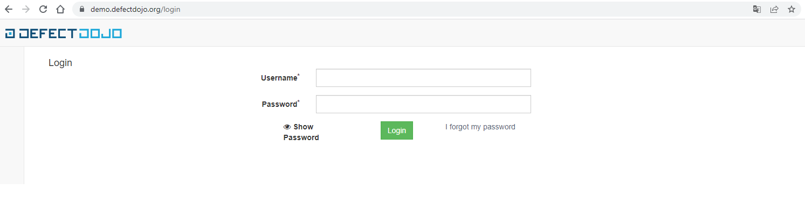
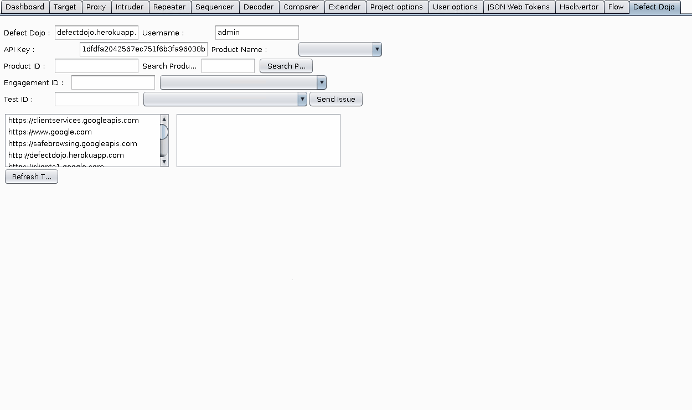

A gestão de vulnerabilidades em TI é crucial para garantir a segurança de sistemas e dados em uma organização. Ela permite identificar e corrigir pontos fracos no sistema antes que sejam explorados por ameaças externas.

  * Introdução
  * Dificuldades na escrita de relatórios de pentest
  * DefectDojo
  * Sobre o projeto
  * Instalação do sistema
  * Considerações

# **Gestão de Vulnerabilidades**

A gestão de vulnerabilidades em TI é crucial para garantir a segurança de sistemas e dados em uma organização. Ela permite identificar e corrigir pontos fracos no sistema antes que sejam explorados por ameaças externas. Além disso, a gestão de vulnerabilidades também é importante para atender a regulamentações e normas de segurança, como o PCI DSS.

Uma abordagem eficaz de gestão de vulnerabilidades inclui a realização de varreduras periódicas para encontrar vulnerabilidades, a classificação das vulnerabilidades com base no risco e a priorização da correção das vulnerabilidades mais críticas. É importante trabalhar com fornecedores de software e hardware para garantir que as vulnerabilidades sejam corrigidas o mais rápido possível.

Além disso, é importante ter um plano de contingência em caso de exploração de vulnerabilidades, incluindo procedimentos para detectar e responder a incidentes de segurança. A equipe de TI deve ser treinada regularmente para reconhecer e lidar com vulnerabilidades e ameaças de segurança.

## **Dificuldades na escrita de relatórios de pentest (Testes de intrusão)**

Realizar um pentest, ou teste de invasão, é uma tarefa desafiadora que exige habilidades técnicas e habilidades de comunicação. Uma das etapas mais importantes do pentest é a elaboração do relatório final, que deve fornecer uma visão geral dos resultados do teste e recomendações para corrigir as vulnerabilidades encontradas. No entanto, escrever um relatório de pentest pode ser uma tarefa difícil, devido aos seguintes desafios:

  1. **Comunicação técnica:** Um dos desafios mais comuns na escrita de relatórios de pentest é comunicar informações técnicas de forma clara e concisa para um público não técnico. Isso exige habilidades de comunicação para traduzir termos técnicos e conceitos complexos em linguagem simples e fácil de entender.

  2. **Organização de dados:** Outro desafio é organizar e apresentar de forma clara e concisa os dados coletados durante o teste de invasão. É importante incluir detalhes sobre as vulnerabilidades encontradas, incluindo sua gravidade, localização e como elas foram exploradas, mas sem sobrecarregar o relatório com informações desnecessárias.

  3. **Recomendações:** Além de identificar vulnerabilidades, é importante fornecer recomendações para corrigi-las. Isso exige uma compreensão profunda do sistema e do negócio para fornecer soluções que sejam eficazes e viáveis ​​para a organização.

  4. **Tempo:** Por fim, escrever um relatório de pentest também pode ser desafiador devido ao tempo limitado para concluir a tarefa. Isso exige uma boa gestão do tempo e habilidades de planejamento para garantir que o relatório seja concluído dentro do prazo estabelecido.

## **DefectDojo**

O DefectDojo é um software open-source que ajuda a gerenciar vulnerabilidades em TI. Ele fornece uma plataforma centralizada para armazenar e gerenciar vulnerabilidades, acompanhar o progresso da correção e gerar relatórios. Algumas das principais funcionalidades do DefectDojo incluem:

  1. Importação de vulnerabilidades de varreduras de segurança automatizadas, como o Nessus ou o OpenVAS.
  2. Classificação das vulnerabilidades com base no risco, permitindo que as vulnerabilidades mais críticas sejam priorizadas para correção.
  3. Acompanhamento de progresso da correção, incluindo a capacidade de adicionar notas, anexar arquivos e definir prazos para a correção.
  4. Gerar relatórios personalizáveis para comunicar o status da gestão de vulnerabilidades para a equipe de segurança e outras partes interessadas.
  5. Integração com outras ferramentas, como o JIRA ou o ServiceNow, para automatizar o fluxo de trabalho de correção de vulnerabilidades.
  6. Suporte a equipe para gerenciar e atribuir vulnerabilidades para as pessoas corretas.

## **O projeto**

Embora a rastreabilidade e as métricas sejam o objetivo final, o DefectDojo é um rastreador de bugs em sua essência. Aproveitar o modelo Product:Engagement do DefectDojo permite a rastreabilidade entre vários projetos e ciclos de teste e permite relatórios refinados.

O código é de código aberto e está disponível no [GitHub](<https://github.com/DefectDojo/django-DefectDojo>)

Um exemplo em execução está disponível no servidor de [demonstração](<https://demo.defectdojo.org/login>), usando as credenciais **admin** /**defectdojo@demo#appsec**.



Observação: o servidor de demonstração é atualizado regularmente e fornecido com alguns dados de amostra.

## **Instalação do sistema**

A instalação do DefectDojo utilizando o Docker é uma maneira fácil e rápida de configurar o software. Os passos detalhados para instalar o DefectDojo usando o Docker são os seguintes:

  1. **Modo 1. Cutomizando o docker** Instale o Docker e o Docker Compose em seu sistema. Isso pode ser feito através do gerenciador de pacotes do seu sistema operacional, como o apt-get no Ubuntu ou o yum no Centos.

```
sudo apt-get install docker-ce
sudo apt-get install docker-compose
```

Faça o clone do repositório do DefectDojo do GitHub e entre na pasta do projeto.

```
git clone https://github.com/DefectDojo/django-DefectDojo.git
cd django-DefectDojo
```

Crie um arquivo chamado “docker-compose.override.yml” na pasta do projeto e adicione as seguintes configurações:

```
version: '3'
services:
  dojo:
    environment:
      - DJANGO_SECRET_KEY=SUA_CHAVE_SECRETA
      - POSTGRES_USER=SEU_USUARIO
      - POSTGRES_PASSWORD=SUA_SENHA
      - POSTGRES_DB=NOME_DO_BANCO
    ports:
      - "8000:8000"
    volumes:
      - .:/opt/defectdojo
```

Essas configurações específicas são para expor a porta 8000, onde o DefectDojo estará disponível, e mapear a pasta do projeto no container.

Execute o seguinte comando para iniciar a instalação:

```
docker-compose up -d
```

Isso vai baixar as imagens necessárias e iniciar os containers.

Acesse a url **http://localhost:8000/** no seu navegador para acessar a interface web do DefectDojo. O primeiro acesso será para configurar o admin do sistema.

Para parar a execução do DefectDojo:

```
docker-compose down
```

Vale lembrar que esses são os passos gerais para instalar o DefectDojo usando o Docker. Pode ser necessário fazer ajustes adicionais de acordo com sua configuração de sistema e necessidades específicas. Certifique-se de ler a documentação do DefectDojo e do Docker para obter mais informações sobre configurações avançadas e problemas comuns.

  1. **Modo 2, simplificado.**

Os passos básicos para instalar o DefectDojo com o Docker incluem:

Instalar o Docker em seu sistema. Isso pode ser feito baixando o pacote de instalação correspondente ao seu sistema operacional no site oficial do Docker.

Baixe a imagem do DefectDojo do Docker Hub. Isso pode ser feito executando o comando:

```
docker pull defectdojo/defectdojo
```

Crie um container com a imagem baixada. Isso pode ser feito executando o comando:

```
docker run --name defectdojo -p 8000:8000 -d defectdojo/defectdojo
```

Acesse o container criado. Isso pode ser feito executando o comando:

```
docker exec -it defectdojo bash
```

Acesse o navegador e digite **http://localhost:8000** para acessar a interface web do DefectDojo.

Siga os passos de configuração inicial do DefectDojo. Isso inclui criar um superusuário, configurar a conexão com o banco de dados e configurar as configurações de email.

É importante lembrar que ao utilizar o DefectDojo via Docker, as configurações e dados serão perdidos ao parar o container, então é recomendado configurar um volume para o banco de dados ou outras configurações importantes.

A instalação do DefectDojo utilizando o Docker é uma forma fácil e rápida de configurar o software. Consiste em baixar a imagem do Docker Hub, criar um container com a imagem e acessar a interface web do DefectDojo. Lembrando que é importante configurar volumes para as configurações e dados importantes.

### Possiveis integrações

  * **Importar dados** Como o DefectDojo importa e reimporta relatórios de ferramentas de segurança.

  * **Relatórios suportados** O DefectDojo tem a capacidade de importar relatórios de verificação de um grande número de ferramentas de segurança.

  * **DefectDojo API v2** A API do DefectDojo permite automatizar tarefas, por exemplo, carregar relatórios de verificação em pipelines de CI/CD.

  * **Autenticação via OAuth2/SAML2** OAuth2/SAML2 permite que os usuários se autentiquem em diretórios corporativos.

  * **Autenticação via LDAP** Autenticar usuários usando LDAP

  * **Integração do JIRA** Integração bidirecional das descobertas do DefectDojo com os problemas do Jira.

  * **Repositórios de código-fonte** Integração de repositórios para navegar até a localização dos achados no código fonte.

  * **Notificações** O DefectDojo pode informá-lo sobre alterações em diferentes canais.

  * **Sincronização do Planilhas Google** Exporte os detalhes da descoberta para o Planilhas Google e carregue as alterações do Planilhas Google.

  * **Plug-in Dojo Burp Professional** Exporte as descobertas diretamente do Burp para o DefectDojo.

  * **Linguagens e linhas de código** Você pode importar uma análise das linguagens usadas em um projeto, incluindo linhas de código.

  * **Proteção contra ataques** Limitação de taxa configurável na página de login para mitigar ataques de força bruta

  * **Exportar dados** DefectDojo tem a capacidade de exportar descobertas.

A imagem abaixo monstra a configuração do plugin do defectdojo no Burpsuite. Para que o plug-in funcione, você precisará ter o Jython configurado no Burp Suite Pro. Para usar este plug-in antes que ele apareça na BApp Store, você precisará fazer o seguinte:

Acesse Extendere selecione a Extensions guia Clique em Add, selecione **Extension Type:** para ser Pythone selecione **oDefectDojoPlugin.py**

**Configuração do Plugin**



## **Considerações finais**

De forma resumida, a gestão de vulnerabilidades em TI é fundamental para garantir a segurança de sistemas e dados e atender a regulamentações e normas de segurança. A realização de varreduras periódicas, a classificação das vulnerabilidades com base no risco, a priorização da correção das vulnerabilidades mais críticas e a implementação de um plano de contingência são elementos-chave de uma abordagem eficaz de gestão de vulnerabilidades.

o DefectDojo é uma ferramenta valiosa para gerenciar vulnerabilidades em TI, pois fornece uma plataforma centralizada para armazenar e gerenciar vulnerabilidades, acompanhar o progresso da correção e gerar relatórios. Ele permite a importação de vulnerabilidades de varreduras de segurança automatizadas, classificação das vulnerabilidades com base no risco, acompanhamento de progresso da correção, geração de relatórios personalizáveis e integração com outras ferramentas de gerenciamento de vulnerabilidades.

Caso tenha despertado seu interesse acesse a documentação do projeto e aprofunde-se nas possibilidades que ele permite.

[Documentação](<https://documentation.defectdojo.com/>)
