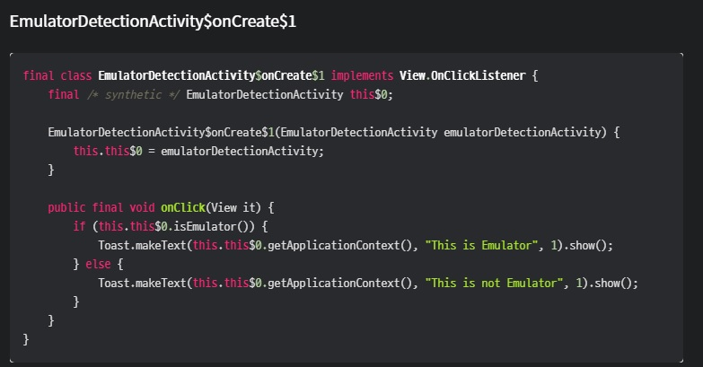
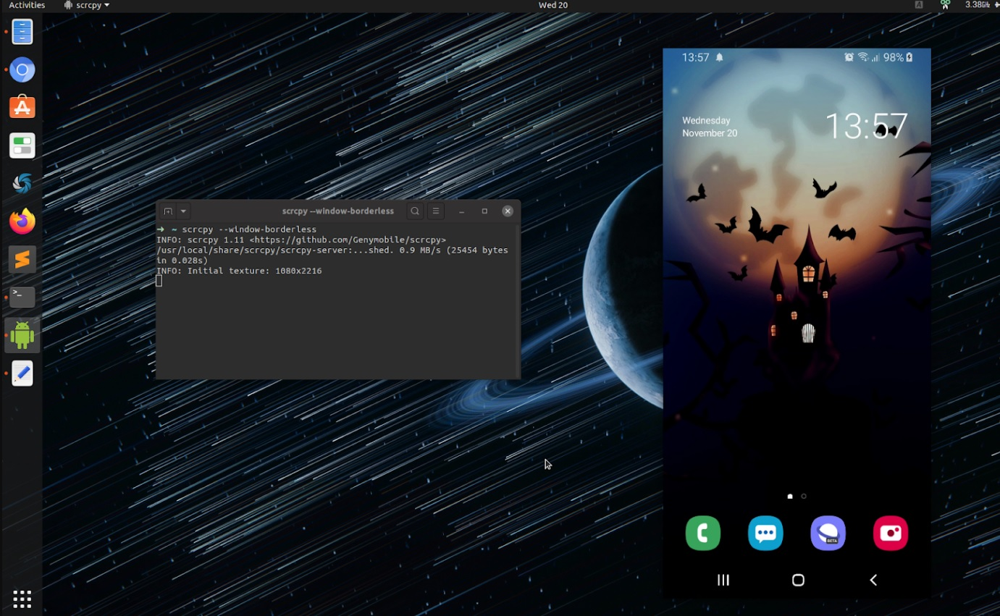
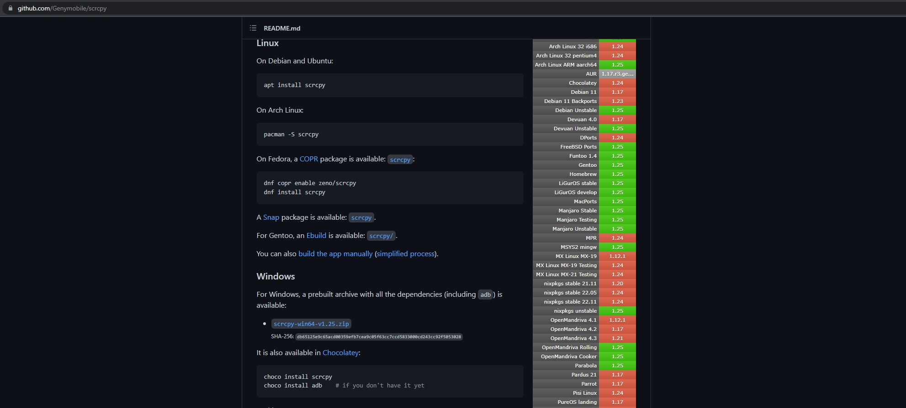

Realizar um pentest em smartphones Android pode apresentar alguns desafios e dificuldades, especialmente se você não tiver muita experiência com esse tipo de atividade.

  * Introdução
  * Proteção contra Emulador - ou anti-VM
  * Importância da Gestão de tempo)
  * SCRCPY
  * Requisitos para uso
  * Instalação do Scrcpy
  * Considerações
  * Sugestões de estudo

## **Dificuldades encontradas em um pentest mobile**

Realizar um pentest em smartphones Android pode apresentar alguns desafios e dificuldades, especialmente se você não tiver muita experiência com esse tipo de atividade. Abaixo, listo algumas das dificuldades mais comuns que podem surgir durante um pentest em um smartphone Android:

  1. **Acesso físico ao dispositivo:** Para realizar um pentest em um smartphone Android, geralmente é necessário ter acesso físico ao dispositivo, o que pode ser difícil de obter em alguns casos. Por exemplo, se o dispositivo estiver protegido por senha ou se o proprietário do dispositivo não estiver disposto a permitir o acesso.

  2. **Diversidade de dispositivos:** Existem muitos modelos de smartphones Android disponíveis no mercado, cada um com suas próprias características e configurações, o que pode tornar o pentest mais complexo. O teste em um modelo de smartphone pode não ser suficiente para cobrir todos os casos, como um pentester precisa ser capaz de testar em uma ampla variedade de dispositivos para garantir que todos os cenários sejam cobertos.

  3. **Fragmentação do sistema operacional:** O sistema operacional Android é altamente fragmentado, o que significa que diferentes versões do sistema operacional são usadas por diferentes dispositivos, o que pode dificultar o desenvolvimento de um método único de ataque. É importante conhecer bem as versões e quais vulnerabilidades são específicas de cada uma delas.

  4. **Implementação de segurança:** Alguns fabricantes implementam medidas de segurança adicionais em seus dispositivos, tornando mais difícil realizar um pentest com sucesso. Por exemplo, alguns dispositivos podem contar com medidas adicionais de segurança, como criptografia de dados e verificações de integridade do sistema.

  5. **Acesso a dados sensíveis:** Durante um pentest em um smartphone Android, é possível que o pentester tenha acesso a dados sensíveis, como informações pessoais ou de contas de terceiros, o que pode levar a problemas legais ou éticos. É importante garantir que todas as informações obtidas durante o teste sejam tratadas com a devida confidencialidade.

Para superar essas dificuldades, é importante ter um bom conhecimento das vulnerabilidades mais comuns em smartphones Android, bem como ter ferramentas e metodologias adequadas para realizar um pentest de forma eficaz e segura. É recomendável contar com a ajuda de profissionais especializados em segurança da informação e ética hacker, para garantir a realização de um pentest seguro e eficiente.

# **Proteção contra VM**

Proteção contra VM: A proteção contra VM também é usada no contexto de aplicativos móveis, especialmente em aplicativos bancários e financeiros, jogos e outros aplicativos que processam informações sensíveis e valiosas.

Os desenvolvedores de aplicativos móveis implementam a proteção contra VM para evitar que seus aplicativos sejam executados em ambientes virtuais, pois esses ambientes são frequentemente usados por atacantes para realizar engenharia reversa, analisar o código do aplicativo, extrair informações sensíveis e desenvolver exploits e ataques contra o aplicativo e seus usuários.

Além disso, a proteção contra VM pode ser usada para evitar que emuladores ou simuladores sejam usados para testar aplicativos, o que pode limitar a eficácia dos testes de segurança realizados pelos desenvolvedores ou pelos profissionais de segurança.

As técnicas de proteção contra VM usadas em aplicativos móveis são semelhantes às usadas em outros tipos de softwares. Algumas das técnicas mais comuns incluem a verificação de dispositivos e sensores específicos do dispositivo, a monitoração do comportamento da CPU, a detecção de emuladores e a análise do tempo de execução do aplicativo.

No entanto, assim como acontece com outras técnicas de proteção, a proteção contra VM não é 100% eficaz e pode ser contornada usando técnicas de engenharia reversa e análise de código. Por isso, os desenvolvedores de aplicativos móveis gerealmente adotam outras medidas de segurança para proteger seus aplicativos, como criptografia, autenticação, verificação de integridade, controle de acesso, entre outros.

## **Importância da gestão de tempo durante um pentest**

A gestão de tempo é extremamente importante durante um pentest (teste de invasão) porque o tempo é um recurso limitado e valioso. Um pentest pode levar dias, semanas ou até meses para ser concluído, e é importante que o testador gerencie seu tempo de forma eficiente para garantir que possa realizar todos os testes necessários dentro do prazo estabelecido.

Diferente de um ação de hackers que possuem tempo indefinido, um pentest tem hora e data de término. Vou citar mais alguns pontos que mostram que gestão de tempo é importante durante um pentest:

  1. **Conclusão do trabalho no prazo:** Um pentest pode ser um processo longo e complexo que envolve várias etapas, como coleta de informações, escaneamento de vulnerabilidades, exploração de vulnerabilidades, relatório de resultados e assim por diante. Uma boa gestão de tempo pode garantir que todas essas etapas sejam concluídas dentro do prazo estabelecido.

  2. **Aproveitamento do tempo de inatividade:** Durante um pentest, é comum que o testador tenha que esperar por resultados, coletar informações ou se comunicar com o cliente ou outros membros da equipe. Um bom gerenciamento de tempo pode ajudar a aproveitar esses momentos de inatividade para realizar outras tarefas, como revisar os resultados dos testes anteriores ou planejar as próximas etapas do teste.

  3. **Foco em áreas críticas:** Um bom gerenciamento de tempo pode ajudar o testador a se concentrar nas áreas mais críticas do sistema ou aplicação que está sendo testada. Isso é importante porque a maioria dos sistemas e aplicativos tem um grande número de vulnerabilidades, e é necessário priorizar quais delas devem ser corrigidas primeiro.

  4. **Melhoria da qualidade do trabalho:** Quando o testador tem tempo suficiente para realizar um pentest, ele pode realizar testes mais detalhados e aprofundados, o que pode levar à descoberta de mais vulnerabilidades e a um relatório de resultados mais completo e preciso.

Tendo dito isso toda atividade que puder otimizar as atividades durante o pentest deve ser considerada.

## **SCRCPY**

Imagine que logo no inicio do pentest você identifica que a aplicação está com a proteção contra emulador, neste caso você possui duas opções:

  * Tentar bypassar a proteção
  * Rodar a aplicação em dispositivo fisico

Caso você escolha a segunda opção o Scrcpy pode te ajudar durante o trabalho.

O **SCRCPY** é uma ferramenta que pode ser muito útil durante um teste de intrusão em um dispositivo Android, pois permite que o pentester visualize e controle o dispositivo diretamente a partir de um computador, sem precisar interagir com o dispositivo fisicamente. Dessa forma, o uso do SCRCPY pode facilitar o processo de testes em vários aspectos, como:

  * Maior eficiência: O SCRCPY permite que o pentester controle o dispositivo Android diretamente do computador, o que pode economizar tempo e aumentar a eficiência do teste. Por exemplo, é possível executar comandos de teste ou aplicar técnicas de engenharia reversa diretamente no dispositivo Android, sem precisar alternar entre o dispositivo e o computador.

  * Acesso remoto: Com o SCRCPY, o pentester pode acessar o dispositivo remotamente, sem precisar estar fisicamente presente no mesmo local que o dispositivo. Isso pode ser especialmente útil para testes em dispositivos que estão em locais remotos ou que não estão disponíveis para o pentester fisicamente.

  * Facilidade de uso: O SCRCPY é fácil de usar e configurar, o que pode tornar o processo de teste mais rápido e eficiente. Além disso, a ferramenta tem uma interface gráfica intuitiva e suporta várias opções de personalização, o que facilita a adaptação às necessidades específicas do teste.

  * Segurança: Ao usar o SCRCPY para controlar o dispositivo Android, o pentester pode evitar a exposição desnecessária a dados sensíveis do dispositivo, como senhas ou informações pessoais. Dessa forma, o teste pode ser realizado de forma mais segura e confidencial.

### Requisitos para o uso do SCRCPY

Antes de começar a utilizar o SCRCPY, você precisa verificar se o seu computador e dispositivo Android atendem aos requisitos necessários. Confira abaixo:

Computador:

  * Sistema operacional: Windows, Linux ou macOS;
  * Conexão USB: USB 3.0 com um cabo USB de qualidade;
  * Bibliotecas: a biblioteca do Android SDK Platform-Tools deve estar instalada e configurada corretamente.

Dispositivo Android:

  * Versão do Android: Android 5.0 (Lollipop) ou superior;
  * Depuração USB: a opção de depuração USB deve estar ativada.

### Instalação e utilização do SCRCPY

Após verificar os requisitos, é possível baixar o SCRCPY através do site oficial do projeto, em [GitHub scrcpy](<https://github.com/Genymobile/scrcpy>). As instruções de instalação estão disponíveis no arquivo README.md do projeto.

Para utilizar o SCRCPY, é preciso conectar o dispositivo Android ao computador via USB e, em seguida, executar o arquivo scrcpy. O programa irá abrir uma janela mostrando a tela do dispositivo Android.

É possível controlar o dispositivo Android utilizando o teclado e o mouse do computador. Alguns dos comandos mais comuns são:

  * Clicar com o botão esquerdo do mouse: toque na tela do dispositivo;
  * Clicar com o botão direito do mouse: voltar à tela anterior;
  * Digitar no teclado: inserir texto no dispositivo;
  * Copiar e colar: copiar e colar texto entre o computador e o dispositivo Android.
  * O SCRCPY também oferece outras opções, como a possibilidade de gravar a tela do dispositivo Android ou alterar a resolução da janela exibida.

**Observação** Como o projeto está em sempre sendo atualizado, entendi ser melhor disponibilizar o endereço do projeto do que reproduzir as formas de instalação.

## Conclusão

O SCRCPY é uma ferramenta útil para quem deseja controlar um dispositivo Android através do computador. Através dele, é possível realizar testes, demonstrações e resolução de problemas de forma mais prática e eficiente. Além disso, o SCRCPY é de código aberto, o que significa que qualquer pessoa pode contribuir com melhorias e correções de bugs.

## Sugestões para estudo

  * [Pentest mobile - h41stur](<https://h41stur.com/posts/mobile-1/>)
  * [Mini treinamento Hacking Mobile Application Android - Hélvio ](<https://www.youtube.com/watch?v=9MM9Gphe0IY&t=4117s>)
  * [Espelhando a tela do smartphone Android no Linux via Wi-Fi (ADB + SCRCPY) - Andre Uebe ](<https://www.vivaolinux.com.br/artigo/Espelhando-a-tela-do-smartphone-Android-no-Linux-via-Wi-Fi-ADB-SCRCPY/>)
